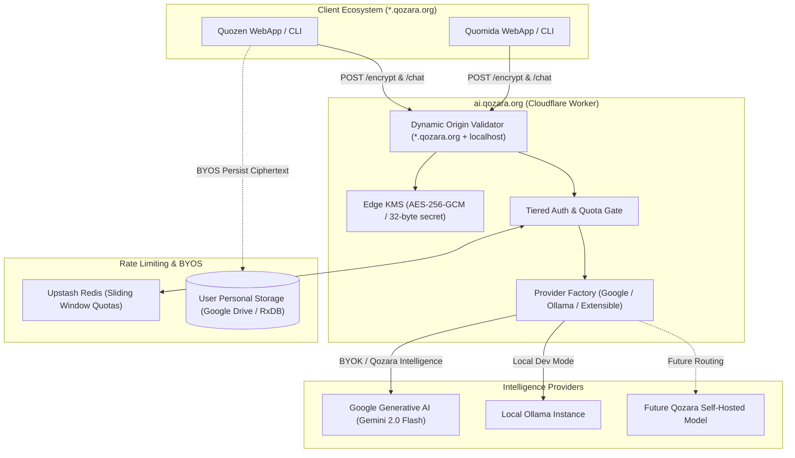

# 🌐 Generic Qozara AI Proxy (`ai.qozara.org`)

A unified, serverless edge AI gateway and isomorphic client SDK (`@qozara/ai-client`) designed for the Qozara ecosystem ([Quozen](https://github.com/qozara/Quozen), [Quomida](https://github.com/qozara/quomida)).

---

## 🏗️ Architectural Overview

The Qozara AI Proxy serves as the central intelligence edge for `*.qozara.org`. It decouples domain-specific client applications from LLM provider APIs and provides zero-server-persistence privacy via **Stateless BYOK Envelope Encryption**.



---

## 🔐 Core Paradigms

### 1. "Qozara Intelligence" vs. Bring-Your-Own-Key (BYOK)
* **Qozara Intelligence (Team / Default — Mode 1A):** A managed, out-of-the-box edge AI tier powered by Gemini 2.0 Flash strictly gated to authenticated Google accounts explicitly registered in Qozara's zero-PII SHA-256 allowlist (`qozara:allowed_users`), enforced with fail-closed per-user quotas (20 req/day) and a global daily circuit breaker (500 req/day). Unauthenticated requests (`401`) and unregistered accounts (`403`) are rejected.
* **Stateless BYOK Envelope Encryption:** Users supply their personal API key. The edge proxy encrypts it with AES-256-GCM using `KMS_SECRET`. The resulting `ciphertext` is stored **only on the user's personal device / cloud storage** (RxDB / Google Drive). The proxy retains **zero database state**.

### 2. Client-Agnostic Abstraction
Clients communicate strictly using standard JSON-Schema tool calling arrays and prompt message lists. The proxy normalizes tool definitions across Google Gemini, Ollama, and future backends (e.g. Cloudflare Workers AI, vLLM).

---

## 📦 Monorepo Structure

* **`apps/worker` (`@qozara/ai-proxy-worker`)**: High-performance Cloudflare Worker built on [Hono](https://hono.dev/) with Web Crypto AES-256-GCM and Upstash rate-limiting.
* **`packages/client` (`@qozara/ai-client`)**: Isomorphic TypeScript client SDK with polymorphic fallback waterfall:
  $$\text{BYOK} \longrightarrow \text{Window.AI (Gemini Nano)} \longrightarrow \text{Local Ollama} \longrightarrow \text{Qozara Intelligence}$$

---

## 📡 API Reference

### `GET /health`
Public health status check (returns `Cache-Control: public, max-age=30, s-maxage=60, stale-while-revalidate=300` so CDN edges absorb floods without edge invocations).
* **Auth:** None
* **Response:**
  ```json
  {
    "status": "ok",
    "service": "qozara-ai-proxy",
    "providers": ["google", "ollama"]
  }
  ```

### `POST /api/v1/agent/encrypt`
Encrypts a personal API key for BYOK storage.
* **Auth:** None required (Protected by dynamic `Origin` CORS check, `64 KB` body limit, and IP burst rate limit).
* **Request:**
  ```json
  { "apiKey": "AIzaSy..." }
  ```
* **Response:**
  ```json
  { "ciphertext": "e2a..." }
  ```

### `POST /api/v1/agent/chat`
Dispatches chat and tool-calling execution.
* **Auth & Tiered Routing (Mode 1A):**
  * **BYOK (`ciphertext` provided):** No Google login required; encrypted key is decrypted statelessly via `KMS_SECRET` and protected by `64 KB` body limit + IP burst limiting (`60` req/min with in-memory 429 flood shielding).
  * **Qozara Intelligence (`ciphertext` omitted):** Strictly requires a verified Google OAuth token (`Authorization: Bearer <google_access_token>`) belonging to a registered account in `qozara:allowed_users` (or `ALLOWED_USER_EMAILS`), capped at `64 KB` HTTP body, 30 messages / 32,768 characters, and `maxOutputTokens: 1024`. Returns `401 UNAUTHORIZED_401` if unauthenticated (with per-IP failure rate limiting and 60s invalid-token memory cache), `403 FORBIDDEN_403` if unregistered, `413 PAYLOAD_TOO_LARGE_413` above `64 KB`, `429 RATE_LIMIT_EXCEEDED` when user (`20/day`) or global (`500/day`) quotas are exceeded, and `503 SERVICE_UNAVAILABLE_503` if Redis is missing or unavailable (fail-closed).
* **Request:**
  ```json
  {
    "messages": [{ "role": "user", "content": "Log lunch for 15" }],
    "systemPrompt": "You are a financial assistant...",
    "tools": [{ "name": "addExpense", "description": "...", "parameters": {} }],
    "ciphertext": "e2a...",
    "byokProvider": "google"
  }
  ```
* **Response (Tool Call):**
  ```json
  {
    "type": "tool_call",
    "tool": "addExpense",
    "arguments": { "amount": 15, "description": "Lunch" }
  }
  ```
* **Response (Text):**
  ```json
  {
    "type": "text",
    "content": "Expense recorded."
  }
  ```

### `GET /admin` & `GET|POST /api/v1/admin/users` (Mode 1A Allowlist Management)
Manages Qozara Intelligence user registrations without storing raw email PII in Redis. Identities are stored in Upstash Redis Set `qozara:allowed_users` as domain-separated SHA-256 digests (`SHA-256("qozara-allowlist-v1:" + normalizedEmail)`), which remain invariant if you rotate `ADMIN_SECRET` or `KMS_SECRET`.

* **Browser Admin Console (`GET /admin`):** Open `https://ai.qozara.org/admin` in your browser (`Cache-Control: no-store`, `Referrer-Policy: no-referrer`, `X-Frame-Options: DENY`) and supply your rotatable `ADMIN_SECRET` (>= 16 characters) to register, revoke, check, or inspect allowlisted user hashes.
* **Browser-Direct / HTTP Endpoint (`GET` or `POST /api/v1/admin/users`):**
  * **Auth:** `Authorization: Bearer <ADMIN_SECRET>`, `X-Admin-Secret: <ADMIN_SECRET>`, or `?secret=<ADMIN_SECRET>` query parameter for direct browser address-bar invocations.
  * **Rate Limit:** 15 requests/minute per client IP.
  * **Browser URL Examples (`GET`):**
    * `https://ai.qozara.org/api/v1/admin/users?action=register&email=user@example.com&secret=YOUR_ADMIN_SECRET`
    * `https://ai.qozara.org/api/v1/admin/users?action=revoke&email=user@example.com&secret=YOUR_ADMIN_SECRET`
    * `https://ai.qozara.org/api/v1/admin/users?action=check&email=user@example.com&secret=YOUR_ADMIN_SECRET`
    * `https://ai.qozara.org/api/v1/admin/users?action=list&secret=YOUR_ADMIN_SECRET`
  * **JSON Body Example (`POST`):**
    ```json
    {
      "action": "register",
      "emails": ["alice@example.com", "bob@example.com"]
    }
    ```

#### CLI Allowlist Management (`npm run users`)
Register, revoke, check, or list registered hashes directly from your terminal (reads `ADMIN_SECRET` and optional `AI_PROXY_URL` from environment variables, root `.env`, or `apps/worker/.dev.vars`):
```bash
npm run users -- register alice@example.com bob@example.com
npm run users -- check alice@example.com
npm run users -- revoke bob@example.com
npm run users -- list
# Optional flags: --url https://ai.qozara.org --secret YOUR_ADMIN_SECRET
```

---

## 🚀 Local Development

### 1. Prerequisites
* Node.js $\ge$ 22.0.0
* npm $\ge$ 10.0.0

### 2. Setup Environment
```bash
cd apps/worker
cp example.dev.vars .dev.vars
```
Generate a random 32-byte KMS secret:
```bash
openssl rand -base64 32 | cut -c1-32
```
Paste it as `KMS_SECRET` in `.dev.vars`.

### 3. Run Worker Locally
```bash
npm run dev --workspace=@qozara/ai-proxy-worker
# Worker will listen on http://localhost:8788
```

### 4. Running Tests
```bash
npm test
```

---

## 🚢 Deployment

### 1. Vercel Edge Deployment (`ai.qozara.org`)
The proxy is continuously deployed to Vercel Edge on every push to `main`:
* **Live Gateway:** `https://ai.qozara.org`
* **Health Check:** `https://ai.qozara.org/health`
* **Root Directory:** `apps/worker`
* **Runtime:** Vercel Edge Function (`export const runtime = 'edge'`)

Environment variables configured in Vercel:
* `KMS_SECRET`: 32-byte secret (raw, base64, or hex)
* `ADMIN_SECRET`: Rotatable secret (>= 16 chars) protecting `/api/v1/admin/users` (rotating does not invalidate Redis hashes)
* `GOOGLE_GENERATIVE_AI_API_KEY`: Dedicated Gemini 2.0 Flash API key
* `GOOGLE_GENERATIVE_AI_MODEL`: `gemini-2.0-flash`
* `AI_PROVIDER`: `google`
* `KV_REST_API_URL` & `KV_REST_API_TOKEN`: Upstash Redis for sliding window quotas, global circuit breaker, and Mode 1A allowlist
* `ALLOWED_USER_EMAILS` (optional): Comma-separated static emails or 64-char SHA-256/HMAC-SHA256 digests (`qozara-allowlist-v1:<email>`)
* `ALLOWLIST_PEPPER` (optional, recommended): Secret pepper for HMAC-SHA256 allowlist hashes in Redis (protects hashes even if Redis is exposed; independent of `ADMIN_SECRET` / `KMS_SECRET`)
* `ALLOWED_GOOGLE_CLIENT_IDS` (optional): Comma-separated Google OAuth Client IDs enforced via Google `tokeninfo` audience check (`aud`/`azp`)
* `AUTH_FAILURE_LIMIT_REQUESTS` (default: `15`): Max failed Bearer token validations per IP per 60s before isolate flood shield returns `429`
* `AI_RATE_LIMIT_REQUESTS` / `AI_RATE_LIMIT_WINDOW` (defaults: `20` / `1 d`): Per-user Qozara Intelligence quota
* `GLOBAL_RATE_LIMIT_REQUESTS` / `GLOBAL_RATE_LIMIT_WINDOW` (defaults: `500` / `1 d`): Global daily circuit breaker

### 2. Cloudflare Workers (Alternative Edge)
Deploy directly to Cloudflare Workers via Wrangler:
```bash
npm run deploy --workspace=@qozara/ai-proxy-worker
```
Configure secrets via Wrangler:
```bash
npx wrangler secret put KMS_SECRET
npx wrangler secret put ADMIN_SECRET
npx wrangler secret put GOOGLE_GENERATIVE_AI_API_KEY
npx wrangler secret put KV_REST_API_URL
npx wrangler secret put KV_REST_API_TOKEN
```
