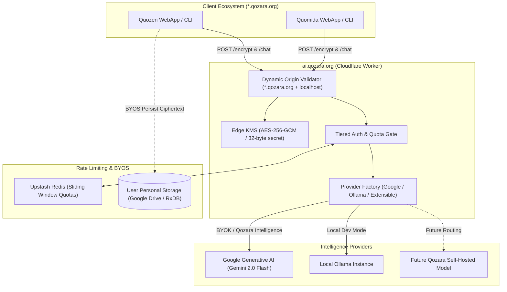

# 🌐 Generic Qozara AI Proxy (`ai.qozara.org`)

A unified, serverless edge AI gateway and isomorphic client SDK (`@qozara/ai-client`) designed for the Qozara ecosystem ([Quozen](https://github.com/qozara/Quozen), [Quomida](https://github.com/qozara/quomida)).

---

## 🏗️ Architectural Overview

The Qozara AI Proxy serves as the central intelligence edge for `*.qozara.org`. It decouples domain-specific client applications from LLM provider APIs and provides zero-server-persistence privacy via **Stateless BYOK Envelope Encryption**.



---

## 🔐 Core Paradigms

### 1. "Qozara Intelligence" vs. Bring-Your-Own-Key (BYOK)
* **Qozara Intelligence (Team / Default):** A managed, out-of-the-box edge AI tier powered by Gemini 2.0 Flash with rate-limiting sliding windows (20 req/day for authenticated Google accounts; 5 req/day for anonymous local-first users).
* **Stateless BYOK Envelope Encryption:** Users supply their personal API key. The edge proxy encrypts it with AES-256-GCM using `KMS_SECRET`. The resulting `ciphertext` is stored **only on the user's personal device / cloud storage** (RxDB / Google Drive). The proxy retains **zero database state**.

### 2. Client-Agnostic Abstraction
Clients communicate strictly using standard JSON-Schema tool calling arrays and prompt message lists. The proxy normalizes tool definitions across Google Gemini, Ollama, and future backends (e.g. Cloudflare Workers AI, vLLM).

---

## 📦 Monorepo Structure

* **`apps/worker` (`@qozara/ai-proxy-worker`)**: High-performance Cloudflare Worker built on [Hono](https://hono.dev/) with Web Crypto AES-256-GCM and Upstash rate-limiting.
* **`packages/client` (`@qozara/ai-client`)**: Isomorphic TypeScript client SDK with polymorphic fallback waterfall:
  $$\text{BYOK} \longrightarrow \text{Window.AI (Gemini Nano)} \longrightarrow \text{Local Ollama} \longrightarrow \text{Qozara Intelligence}$$

---

## 📡 API Reference

### `GET /health`
Public health status check.
* **Auth:** None
* **Response:**
  ```json
  {
    "status": "ok",
    "service": "qozara-ai-proxy",
    "providers": ["google", "ollama"]
  }
  ```

### `POST /api/v1/agent/encrypt`
Encrypts a personal API key for BYOK storage.
* **Auth:** None required (Protected by dynamic `Origin` CORS check + IP burst rate limit).
* **Request:**
  ```json
  { "apiKey": "AIzaSy..." }
  ```
* **Response:**
  ```json
  { "ciphertext": "e2a..." }
  ```

### `POST /api/v1/agent/chat`
Dispatches chat and tool-calling execution.
* **Auth:** Optional `Authorization: Bearer <google_access_token>`.
* **Request:**
  ```json
  {
    "messages": [{ "role": "user", "content": "Log lunch for 15" }],
    "systemPrompt": "You are a financial assistant...",
    "tools": [{ "name": "addExpense", "description": "...", "parameters": {} }],
    "ciphertext": "e2a...",
    "byokProvider": "google"
  }
  ```
* **Response (Tool Call):**
  ```json
  {
    "type": "tool_call",
    "tool": "addExpense",
    "arguments": { "amount": 15, "description": "Lunch" }
  }
  ```
* **Response (Text):**
  ```json
  {
    "type": "text",
    "content": "Expense recorded."
  }
  ```

---

## 🚀 Local Development

### 1. Prerequisites
* Node.js $\ge$ 22.0.0
* npm $\ge$ 10.0.0

### 2. Setup Environment
```bash
cd apps/worker
cp example.dev.vars .dev.vars
```
Generate a random 32-byte KMS secret:
```bash
openssl rand -base64 32 | cut -c1-32
```
Paste it as `KMS_SECRET` in `.dev.vars`.

### 3. Run Worker Locally
```bash
npm run dev --workspace=@qozara/ai-proxy-worker
# Worker will listen on http://localhost:8788
```

### 4. Running Tests
```bash
npm test
```

---

## 🚢 Deployment

Deploy directly to Cloudflare Workers:
```bash
npm run deploy --workspace=@qozara/ai-proxy-worker
```
Configure secrets in Cloudflare Dashboard or via Wrangler:
```bash
npx wrangler secret put KMS_SECRET
npx wrangler secret put GOOGLE_GENERATIVE_AI_API_KEY
npx wrangler secret put KV_REST_API_URL
npx wrangler secret put KV_REST_API_TOKEN
```
